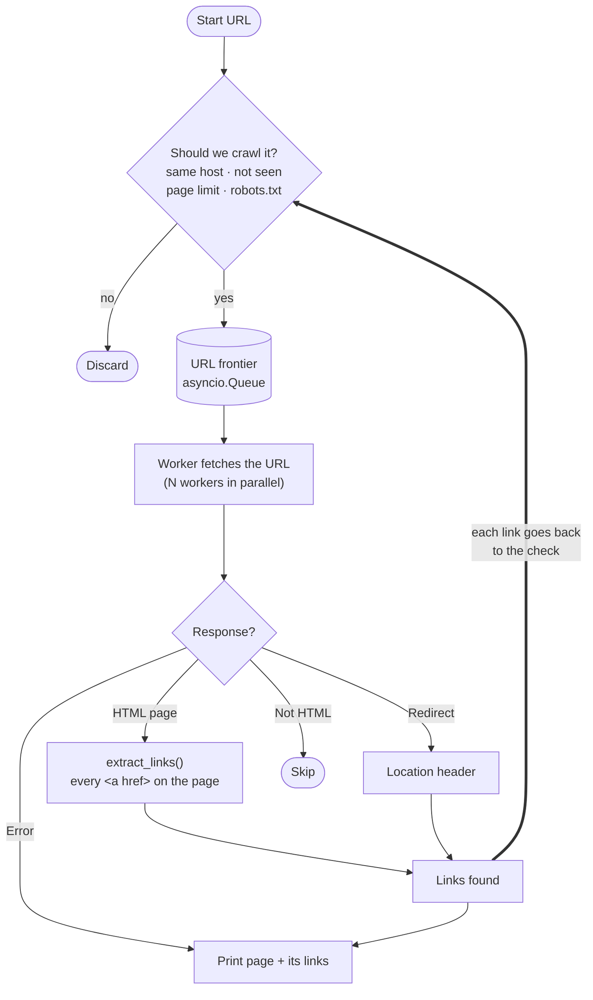

# python-developer-test

# Zego

## About Us

At Zego, we understand that traditional motor insurance holds good drivers back.
It's too complicated, too expensive, and it doesn't reflect how well you actually drive.
Since 2016, we have been on a mission to change that by offering the lowest priced insurance for good drivers.

From van drivers and gig economy workers to everyday car drivers, our customers are the driving force behind everything we do. We've sold tens of millions of policies and raised over $200 million in funding. And we’re only just getting started.

## Our Values

Zego is thoroughly committed to our values, which are the essence of our culture. Our values defined everything we do and how we do it.
They are the foundation of our company and the guiding principles for our employees. Our values are:

<table>
    <tr><td></td><td><b>Blaze a trail</b></td><td>Emphasize curiosity and creativity to disrupt the industry through experimentation and evolution.</td></tr>
    <tr><td></td><td><b>Drive to win</b></td><td>Strive for excellence by working smart, maintaining well-being, and fostering a safe, productive environment.</td></tr>
    <tr><td></td><td><b>Take the wheel</b></td><td>Encourage ownership and trust, empowering individuals to fulfil commitments and prioritize customers.</td></tr>
    <tr><td></td><td><b>Zego before ego</b></td><td>Promote unity by working as one team, celebrating diversity, and appreciating each individual's uniqueness.</td></tr>
</table>

## The Engineering Team

Zego puts technology first in its mission to define the future of the insurance industry.
By focusing on our customers' needs we're building the flexible and sustainable insurance products
and services that they deserve. And we do that by empowering a diverse, resourceful, and creative
team of engineers that thrive on challenge and innovation.

### How We Work

- **Collaboration & Knowledge Sharing** - Engineers at Zego work closely with cross-functional teams to gather requirements,
  deliver well-structured solutions, and contribute to code reviews to ensure high-quality output.
- **Problem Solving & Innovation** - We encourage analytical thinking and a proactive approach to tackling complex
  problems. Engineers are expected to contribute to discussions around optimization, scalability, and performance.
- **Continuous Learning & Growth** - At Zego, we provide engineers with abundant opportunities to learn, experiment and
  advance. We positively encourage the use of AI in our solutions as well as harnessing AI-powered tools to automate
  workflows, boost productivity and accelerate innovation. You'll have our full support to refine your skills, stay
  ahead of best practices and explore the latest technologies that drive our products and services forward.
- **Ownership & Accountability** - Our team members take ownership of their work, ensuring that solutions are reliable,
  scalable, and aligned with business needs. We trust our engineers to take initiative and drive meaningful progress.

## Who should be taking this test?

This test has been created for all levels of developer, Junior through to Staff Engineer and everyone in between.
Ideally you have hands-on experience developing Python solutions using Object Oriented Programming methodologies in a commercial setting. You have good problem-solving abilities, a passion for writing clean and generally produce efficient, maintainable scaleable code.

## The test 🧪

Create a Python app that can be run from the command line that will accept a base URL to crawl the site.
For each page it finds, the script will print the URL of the page and all the URLs it finds on that page.
The crawler will only process that single domain and not crawl URLs pointing to other domains or subdomains.
Please employ patterns that will allow your crawler to run as quickly as possible, making full use any
patterns that might boost the speed of the task, whilst not sacrificing accuracy and compute resources.
Do not use tools like Scrapy or Playwright. You may use libraries for other purposes such as making HTTP requests, parsing HTML and other similar tasks.

## The objective

This exercise is intended to allow you to demonstrate how you design software and write good quality code.
We will look at how you have structured your code and how you test it. We want to understand how you have gone about
solving this problem, what tools you used to become familiar with the subject matter and what tools you used to
produce the code and verify your work. Please include detailed information about your IDE, the use of any
interactive AI (such as Copilot) as well as any other AI tools that form part of your workflow.

You might also consider how you would extend your code to handle more complex scenarios, such a crawling
multiple domains at once, thinking about how a command line interface might not be best suited for this purpose
and what alternatives might be more suitable. Also, feel free to set the repo up as you would a production project.

Extend this README to include a detailed discussion about your design decisions, the options you considered and
the trade-offs you made during the development process, and aspects you might have addressed or refined if not constrained by time.

# Instructions

1. Create a repo.
2. Tackle the test.
3. Push the code back.
4. Add us (@nktori, @danyal-zego, @bogdangoie, @cypherlou, @marliechiller, @ZEGODiogoAlves, and @BarryMcAuley) as collaborators and tag us to review.
5. Notify your TA so they can chase the reviewers.

---

# Solution

A single-domain web crawler in Python 3.14, built on `asyncio`, `httpx` and `lxml`.

## Usage

Requires [uv](https://docs.astral.sh/uv/).

```bash
make install                                # install dependencies and git hooks
uv run crawler https://books.toscrape.com
uv run crawler https://books.toscrape.com -n 50 -c 20 -f jsonl
make check                                  # lint, type-check and test
```

Or with Docker:

```bash
docker build -t zego-crawler .
docker run --rm zego-crawler https://books.toscrape.com -n 20
```

| Option | Default | Description |
| --- | --- | --- |
| `-c, --concurrency` | 10 | Max simultaneous requests |
| `-n, --max-pages` | no limit | Max pages to crawl |
| `-t, --timeout` | 10 | Request timeout in seconds |
| `-r, --retries` | 2 | Retries for connection errors, 429 and 5xx |
| `-f, --format` | `text` | `text` or `jsonl` |
| `--ignore-robots` | off | Ignore `robots.txt` |
| `-v`, `-vv` | off | Info or debug logging to stderr |

Each crawled page is printed with every link found on it. `=>` marks a redirect and `!` an error:

```
https://example.com/
  - https://example.com/about
  - https://other-site.com/
https://example.com/old-page
  => https://example.com/new-page
https://example.com/broken
  ! error: HTTP 404
```

`-f jsonl` prints one JSON object per page instead:

```json
{"url": "https://example.com/", "status": 200, "links": ["https://example.com/about"], "redirect": false, "error": null}
```

## Code layout

```
src/crawler/
  cli.py        command-line entry point
  crawler.py    worker pool, URL frontier, scoping rules
  fetcher.py    HTTP client with retries and content checks
  parser.py     extracts <a href> links with lxml
  urls.py       URL normalisation and same-host check
  robots.py     robots.txt rules
  reporters.py  text and JSON Lines output
tests/
  unit/         isolated tests with mocked HTTP
  integration/  crawls a real local test site
```

## Design

The crawl is a breadth-first search of a graph where pages are nodes and links are edges. The URL frontier
is the queue of pages found but not yet fetched.



The crawl finishes when the queue is empty and no worker is busy.

### Decisions

**asyncio with a fixed worker pool.** Crawling is mostly waiting on the network, so one event loop can keep
many requests in flight. A fixed number of workers caps concurrency and memory however big the site is.
Threads cost more per connection; processes add complexity without helping I/O-bound work.

**One shared HTTP client.** All requests go to one host, so reusing connections avoids repeated TCP and TLS
handshakes. `httpx` over `aiohttp` for its typed API and easy mocking with `respx`.

**Parsing in a thread.** `lxml` parses HTML outside the GIL, so `asyncio.to_thread` keeps the event loop
free for other requests. Link normalisation afterwards is plain Python and still holds the GIL. `lxml` over
BeautifulSoup for speed; BeautifulSoup would mostly have wrapped the same parser.

**Python 3.14.** The newest release still getting bug fixes; 3.12 and 3.13 are security-fix only or about to
be. The no-GIL build would only speed up link normalisation, which isn't the bottleneck.

**De-duplicate when queuing.** URLs are marked as seen when queued, not when fetched, so two workers can't
fetch the same page. Everything runs on one thread, so no locks are needed.

**URL normalisation.** URLs are put in a standard form before comparing, so `/a`, `/a#top` and
`HTTPS://Site.com:443/a` count as one page. Query strings are kept as they often mean different content.

**Redirects aren't followed automatically.** The target is reported as the page's only link and goes
through the same checks as any other, so a redirect can't lead to another domain.

**Only HTML is downloaded.** `Content-Type` is checked before reading the body, and HTML is capped at 10 MB.

**Retries.** Connection errors, timeouts, 429 and 5xx are retried with backoff and jitter, respecting
`Retry-After`. One failing page never stops the crawl.

**Interfaces between components.** `Crawler` depends on interfaces for fetching, URL rules and output, so
it's easy to test with fakes and to extend.

### Assumptions

- "Same domain" means the exact host and port of the start URL. `www.` and other subdomains count as
  different sites; `http` and `https` on the same host count as the same one.
- "URLs found on the page" means every `<a href>`, including external links, but not `mailto:` and similar.
  Only same-host links are crawled. Each page's links are listed once, in page order.
- `robots.txt` is respected unless `--ignore-robots` is passed.
- `/` and `/index.html` are different URLs, so both are crawled even if they return the same page.

### Performance

First 100 pages of `books.toscrape.com`, a site built for scraping practice:

| Concurrency | Time | Peak memory |
| --- | --- | --- |
| 1 | 24.3 s | 38 MB |
| 10 | 3.3 s | 43 MB |

About 7× faster for 5 MB more memory. Above 10 to 20 concurrent requests, the target server becomes the
limit.

## Testing

`make check` runs `ruff`, `mypy --strict` and the tests with branch coverage. CI requires 90%; it's
currently 99%.

- Unit tests cover URL handling and parsing with tables of edge cases, and the fetcher against mocked HTTP.
  The crawler runs against a fake fetcher to check each URL is fetched once, concurrency stays within the
  limit, and a failing page doesn't stop the crawl.
- Integration tests crawl a real local web server. The test site has a `robots.txt`-blocked section, a PDF,
  a broken link, external links and a redirect.

## Production setup

- **CI** (GitHub Actions) runs linting, type checks, tests and a Docker build, and fails if `uv.lock` is out
  of date.
- **Dependabot** updates Python packages, GitHub Actions and Docker images weekly. Dev tools are grouped into
  one PR; runtime dependencies get one PR each.
- **pre-commit** runs the same checks before each commit.
- **Docker** uses a multi-stage build and a non-root user. Base images are pinned to an exact version and
  digest so builds are reproducible.

## Crawling many domains

This version crawls one domain per run. The simplest next step is one `Crawler` per domain in the same
process with a global connection limit, which works today for a few dozen domains.

Beyond that, a CLI isn't a good fit: crawls need to survive crashes, scale across machines, run on a
schedule and report progress. A possible design:

- **Jobs**: an API (FastAPI) or orchestrator (Airflow, Dagster) creates crawl jobs, tracked in Postgres.
- **Frontier**: a durable queue partitioned by domain (Kafka, SQS FIFO or Redis Streams), so each domain's
  rate limit has one owner.
- **Seen set**: shared in Redis, or a Bloom filter for very large crawls.
- **Workers**: stateless containers running the existing crawler code, scaled on queue depth.
- **Results**: JSON Lines records to Kafka or Parquet on S3, then the warehouse, where the link graph can be
  queried.
- **Monitoring**: pages per second, errors and queue depth per domain.

## Future work

- If the start URL redirects to another host (for example `example.com` to `www.example.com`), use the new
  host for the crawl. Today the crawl stops after reporting the redirect.
- Per-host rate limiting and `Crawl-delay`.
- Detect duplicate pages by content hash, and support `<link rel="canonical">`.
- Protection against crawler traps: maximum depth, per-path limits, removing tracking parameters.
- Use `sitemap.xml` to find pages.
- HTTP/2, to send many requests over one connection.
- Resume interrupted crawls.
- JavaScript-rendered sites would need a headless browser, which the brief rules out.

## Tools

- **IDE**: VS Code.
- **AI**: Claude Code, used throughout to scaffold the project, write code, tests and documentation, and
  explain parts of the code. I reviewed its changes and asked for corrections where I disagreed.
- **Tooling**: `uv`, `ruff`, `mypy`, `pytest` (with `pytest-asyncio`, `respx`, `pytest-cov`), `pre-commit`,
  Docker and GitHub Actions.
- **Checking the results**: the test suite, plus manual crawls of `books.toscrape.com` at different
  concurrency levels.
